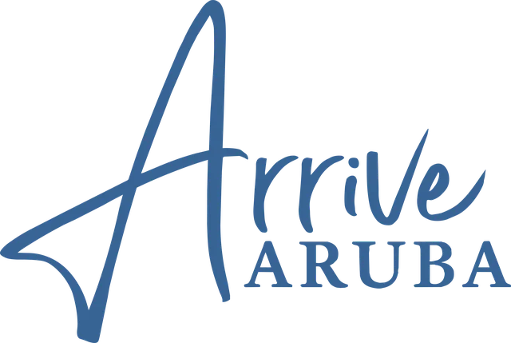
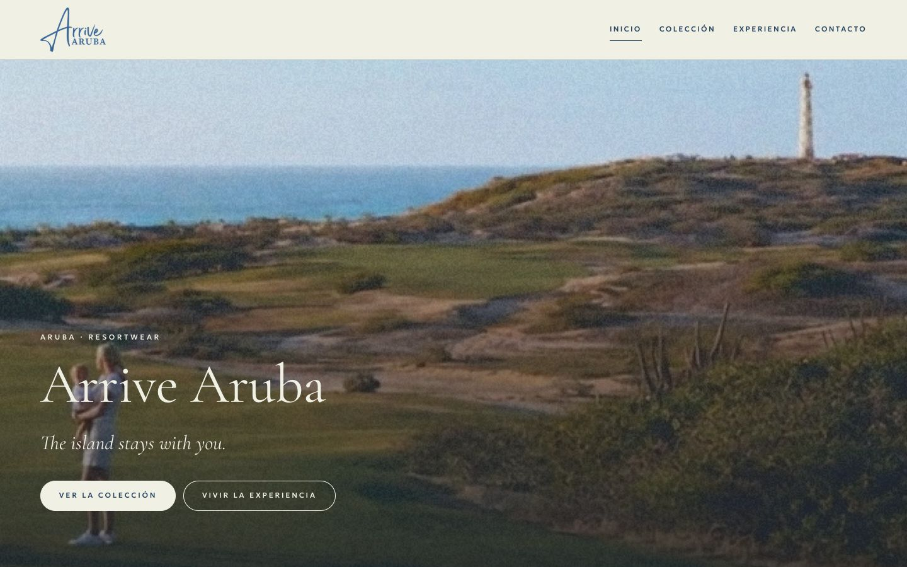
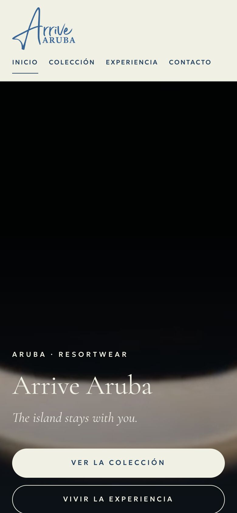
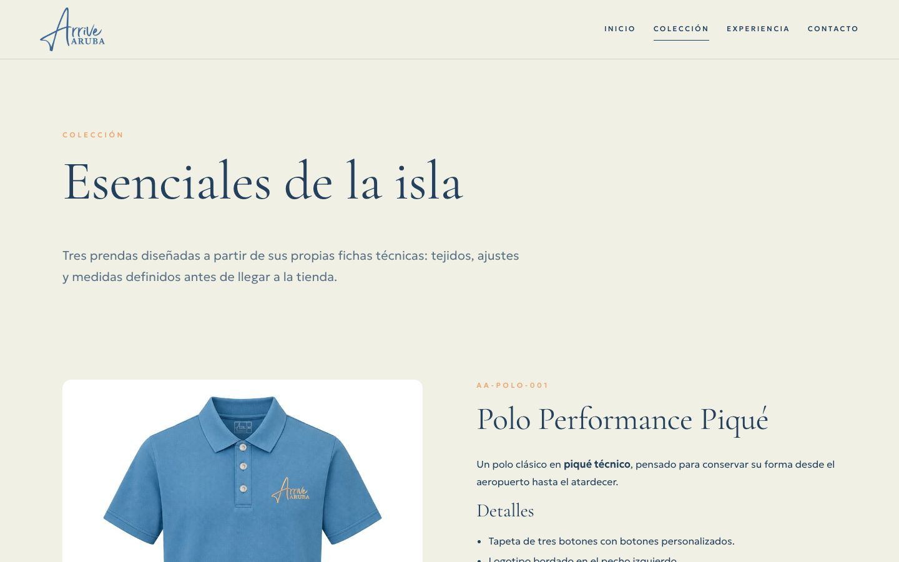
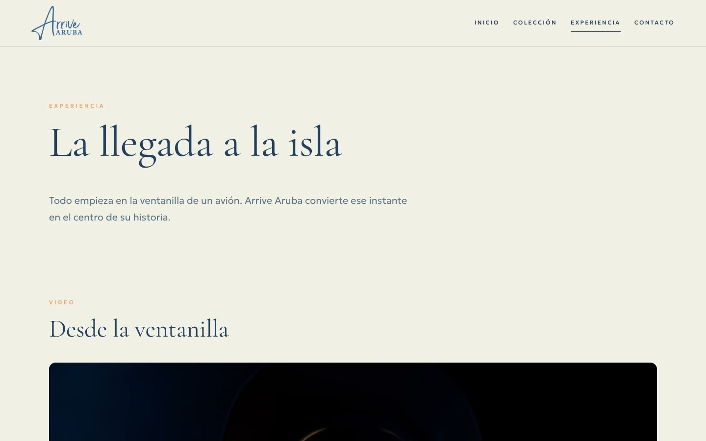

<p align="center">
  
</p>

<h1 align="center">ARRIVE ARUBA — HTML5 EDITION</h1>

<p align="center">
  Adaptación académica de la identidad de Arrive Aruba en HTML5 semántico, CSS3 y JavaScript nativo mínimo.<br>
  e-actividad 2.1 · Diseño web con HTML · Frontend
</p>

<p align="center">
  
  
  
  
  <a href="https://github.com/morfemartin/arrive-aruba-html5/actions/workflows/validate.yml"></a>
  <a href="https://morfemartin.github.io/arrive-aruba-html5/"></a>
</p>

<p align="center"><strong>Sitio publicado:</strong> <a href="https://morfemartin.github.io/arrive-aruba-html5/">https://morfemartin.github.io/arrive-aruba-html5/</a></p>



## Descripción

**Arrive Aruba** es una marca de ropa resort nacida en Aruba. Esta edición traslada su identidad visual (logotipo, paleta, tipografía editorial y narrativa de la «llegada a la isla») a un sitio estático de cuatro páginas, construido para demostrar el uso correcto de HTML5.

No es la tienda comercial: no tiene carrito, precios ni pagos. Es una implementación académica independiente, autónoma y publicable en GitHub Pages.

## Contexto académico

| Campo | Valor |
|---|---|
| Asignatura | Frontend (FrontEndIVIVFI2026C) |
| Docente | Prof. Anggelo Huz |
| Actividad | e-actividad 2.1 — Diseño web con HTML (15 %) |
| Entrega | 17 de octubre de 2026, 23:59 |
| Modalidad | Individual |

## Características principales

- Cuatro páginas HTML5 enlazadas entre sí.
- Semántica completa: `header`, `nav`, `main`, `section`, `article`, `aside`, `footer`, `figure` y `figcaption`.
- Dos tablas con datos reales de las fichas técnicas de las prendas.
- Formulario accesible con validación nativa y sin envío simulado.
- Video con dos formatos y descripción de escenas mediante `<track>`, y audio con dos formatos.
- Diseño adaptable a teléfono, tableta y escritorio.
- Validado con el Nu Html Checker del W3C: 0 errores y 0 avisos.

## Tecnologías

| Tecnología | Uso |
|---|---|
| HTML5 | Estructura y semántica de las cuatro páginas |
| CSS3 | Identidad visual, cuadrículas, animaciones suaves y adaptación responsive |
| JavaScript nativo | Mejoras progresivas (sin bibliotecas) |
| Google Fonts | Cormorant Garamond (licencia SIL OFL 1.1) |
| Geologica | Tipografía local (licencia SIL OFL 1.1, incluida en `assets/fonts/`) |
| FFmpeg | Preparación de video WebM, audio y póster |

## Arquitectura

```text
arrive-aruba-html5/
├── index.html · coleccion.html · experiencia.html · contacto.html
├── assets/   images · video · audio · fonts · icons
├── css/      styles.css · responsive.css
├── js/       main.js
└── docs/     documentación académica y capturas
```

Detalle completo en [docs/ARQUITECTURA.md](docs/ARQUITECTURA.md).

## Instalación y ejecución

No requiere instalar dependencias.

1. Descarga o clona el repositorio:

   ```bash
   git clone https://github.com/morfemartin/arrive-aruba-html5.git
   cd arrive-aruba-html5
   ```

2. Inicia un servidor local (Python viene instalado en macOS y en la mayoría de sistemas Linux):

   ```bash
   python3 -m http.server 8000
   ```

3. Abre `http://localhost:8000` en el navegador.

> **¿Por qué un servidor local?** Si abres `index.html` con doble clic (`file://`), el sitio se ve, pero algunos navegadores bloquean por seguridad la pista de descripciones del video. Con un servidor local o en GitHub Pages funciona todo.

## Navegación

| Página | Contenido |
|---|---|
| [`index.html`](index.html) | Portada, historias editoriales, prendas destacadas y cita de marca |
| [`coleccion.html`](coleccion.html) | Tres prendas con fichas, tabla comparativa y tabla de medidas |
| [`experiencia.html`](experiencia.html) | Video, audio, momentos de la llegada y el símbolo del divi-divi |
| [`contacto.html`](contacto.html) | Formulario de contacto de demostración |

<p>
  
  
</p>



## Etiquetas HTML5 implementadas

| Categoría | Etiquetas | Dónde |
|---|---|---|
| Estructura | `<!DOCTYPE html>`, `html`, `head`, `meta`, `title`, `link`, `body`, `script` | Todas |
| Semántica | `header`, `nav`, `main`, `section`, `article`, `aside`, `footer` | Todas |
| Figuras | `figure`, `figcaption` | Inicio, colección y experiencia |
| Texto | `h1`, `h2`, `h3`, `p`, `strong`, `em`, `blockquote`, `small`, `span`, `a` | Todas |
| Listas | `ul`, `ol`, `li`, `dl`, `dt`, `dd` | Colección, experiencia y contacto |
| Tablas | `table`, `caption`, `thead`, `tbody`, `tfoot`, `tr`, `th`, `td` | Colección |
| Formularios | `form`, `fieldset`, `legend`, `label`, `input`, `select`, `option`, `textarea`, `button` | Contacto |
| Multimedia | `img`, `video`, `audio`, `source`, `track` | Todas (`img`) y experiencia |

## Matriz de cumplimiento

Resumen; el detalle con evidencias está en [docs/MATRIZ-DE-CUMPLIMIENTO.md](docs/MATRIZ-DE-CUMPLIMIENTO.md).

| Requisito | Estado |
|---|---|
| REQ-001 a REQ-009 (estructura, semántica, texto, listas, tablas, formularios, multimedia, páginas y sintaxis) | Cumple, con evidencia |
| REQ-010 Originalidad y autoría | Cumple parcialmente: falta la confirmación del docente sobre el código asistido por IA |
| REQ-011 Ortografía | Cumple parcialmente: falta la lectura final del estudiante |
| REQ-012 Referencias APA 7 | Cumple |
| REQ-013 Entrega (GitHub y ZIP) | Cumple parcialmente: repositorio publicado; falta la cédula para el nombre del ZIP |
| REQ-014 Video | Cumple parcialmente: guion listo; la grabación corresponde al estudiante |

## Validación

| Prueba | Herramienta | Resultado |
|---|---|---|
| HTML | Nu Html Checker (W3C) | 0 errores y 0 avisos en las cuatro páginas |
| CSS | CSS Validation Service (W3C) | 0 errores; 9 avisos explicados |
| Enlaces e IDs | Script de comprobación | 101 referencias, 0 rotas; 0 IDs duplicados |
| Responsive | Chrome automatizado (375, 768 y 1440 px) | Sin desbordamiento horizontal |
| Multimedia y formulario | Chrome automatizado por HTTP | Funcionan según lo esperado |

El flujo de GitHub Actions ([.github/workflows/validate.yml](.github/workflows/validate.yml)) valida el HTML con el validador oficial en cada cambio; [su primera ejecución](https://github.com/morfemartin/arrive-aruba-html5/actions/runs/38971143151) terminó con éxito. Informe completo: [docs/CONTROL-DE-CALIDAD.md](docs/CONTROL-DE-CALIDAD.md).

## Accesibilidad

- Enlace para saltar al contenido principal.
- Textos alternativos descriptivos e imágenes decorativas con `alt=""`.
- Jerarquía de encabezados sin saltos y un único `h1` por página.
- Página activa marcada con `aria-current="page"`.
- Foco visible y navegación completa con teclado.
- Etiquetas asociadas a todos los campos del formulario.
- Animaciones desactivadas si el sistema solicita movimiento reducido.

No se ha ejecutado una auditoría con Lighthouse ni con lector de pantalla, por lo que no se publican puntuaciones.

## Diseño responsive

El diseño parte del móvil y se amplía en dos puntos de ruptura: **600 px** (cuadrículas a dos columnas) y **900 px** (composiciones editoriales a dos columnas). Las tablas se desplazan dentro de su propio contenedor en pantallas estrechas.

## Procedencia y custodia de los recursos

Los recursos de marca (logotipos, fotografías, video y favicon) proceden del proyecto original de Arrive Aruba, propiedad del equipo creador. Se **copiaron** a este repositorio sin modificar el original, que se trató como solo lectura. El registro completo, con la comprobación de integridad, está en [docs/CUSTODIA-DEL-ORIGINAL.md](docs/CUSTODIA-DEL-ORIGINAL.md).

## Autoría y uso de herramientas

- **Autor:** Martin Alejandro Morfe Carballo.
- **Código:** escrito específicamente para este proyecto (HTML, CSS y JavaScript), sin bibliotecas ni plantillas externas.
- **Asistencia de IA:** el código y la documentación se elaboraron con la asistencia de un asistente de programación de IA (Claude, de Anthropic), bajo la dirección y la revisión del autor.
- **Recursos reutilizados:** recursos gráficos y multimedia del proyecto propio Arrive Aruba (ver la sección anterior).
- **Recursos externos:** tipografías de Google Fonts con licencia SIL OFL 1.1.

## Referencias

Ver [docs/REFERENCIAS-APA.md](docs/REFERENCIAS-APA.md) (formato APA 7).

## Estado del desarrollo

| Hito | Estado |
|---|---|
| Sitio de cuatro páginas | Terminado y validado |
| Documentación | Terminada |
| Repositorio en GitHub | Publicado: [morfemartin/arrive-aruba-html5](https://github.com/morfemartin/arrive-aruba-html5) |
| GitHub Pages | Publicado y verificado: [https://morfemartin.github.io/arrive-aruba-html5/](https://morfemartin.github.io/arrive-aruba-html5/) |
| ZIP de entrega | Pendiente de la cédula del estudiante |
| Video explicativo | Guion listo; grabación pendiente |

## Entrega

- Repositorio: [github.com/morfemartin/arrive-aruba-html5](https://github.com/morfemartin/arrive-aruba-html5).
- Sitio publicado: [https://morfemartin.github.io/arrive-aruba-html5/](https://morfemartin.github.io/arrive-aruba-html5/).
- ZIP de respaldo: `cedula_nombre.zip`, con la cédula y el nombre reales del estudiante. Formato ZIP, no RAR.
- Guion del video: [docs/GUION-VIDEO.md](docs/GUION-VIDEO.md).

## Licencia y reutilización

**Todos los derechos reservados.** El nombre, el logotipo, las fotografías, el video y demás recursos de Arrive Aruba pertenecen a sus titulares y no pueden reutilizarse sin autorización. Las tipografías Geologica y Cormorant Garamond se rigen por la licencia SIL Open Font License 1.1.
